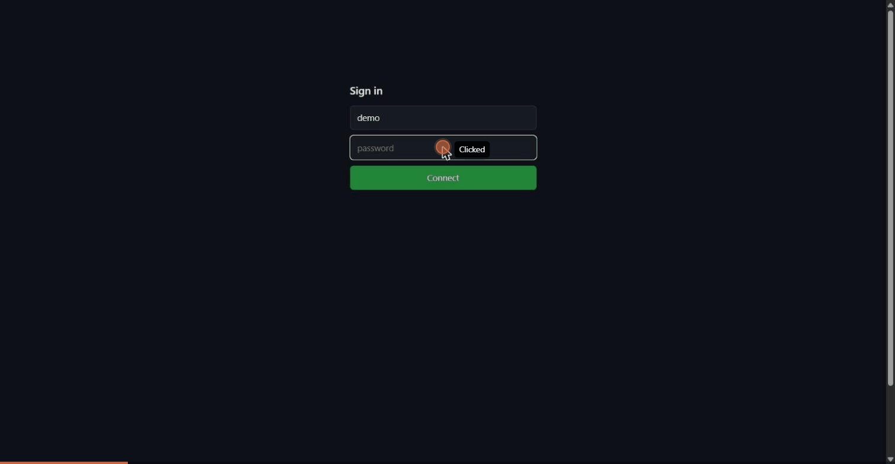

<div align="center">

# 🔑 ssh-over-websocket

### SSH into a machine behind NAT, through a Cloudflare Tunnel. From a browser, `curl`, or a stock `ssh` client.

[](LICENSE)
[](package.json)
[](https://github.com/Sadashii/ssh-over-websocket/stargazers)
[](https://github.com/Sadashii/ssh-over-websocket/issues)

<!-- Add a terminal GIF here: docs/demo.gif -->
<!--  -->

```bash
curl -s ssh.example.com/c | sh
```

**One pasted line. One password. A real SSH session to a laptop with no public IP.**

</div>

---

## 😤 The pain

You want `ssh you@home.example.com` to work from anywhere. Your machine sits on campus Wi-Fi, a carrier-grade NAT, or a hotel network, so nothing on the internet can reach it. A Cloudflare Tunnel solves half of that: your machine dials out, and Cloudflare sends requests back down the connection.

Then you hit the wall:

| 🧱 Obstacle | Why it blocks you |
|---|---|
| Cloudflare does not listen on port 22 | Its shared IPs accept HTTP(S) only. |
| Cloudflare routes by hostname | HTTP has a `Host` header and TLS has SNI. SSH has neither, so the edge cannot tell whose server a raw SSH connection is for. |
| SSH to port 443 gets `400 Bad Request` | The edge parses `SSH-2.0-OpenSSH_...` as an HTTP request line and rejects it. |
| The official fix needs client software | `cloudflared access ssh` or WARP must be installed on every device, and Access adds a login step. |
| Spectrum forwards raw TCP | It is a paid product. |

A bare `ssh you@host` on a device with no setup cannot work without a public-IP host. This project removes the setup instead: **every route below needs one pasted line at most and installs nothing.**

## ✨ Why you will like it

| | Benefit |
|---|---|
| 🔐 | **Password only.** No Google login, no email code, no Cloudflare Access page. Type the password from memory. |
| 🧰 | **Nothing to install on the client.** `curl`, a browser, or the `ssh` you already have. |
| 🔒 | **Real SSH, end to end.** The `/c` route pins the host key and keeps the session encrypted between your client and sshd. |
| 🌐 | **Works behind NAT.** The machine only makes outbound connections. |
| ⚡ | **Fast enough to live in.** About 0.3 s per keystroke round trip through Cloudflare. |
| 🛡️ | **Abuse limits built in.** Failed-login blocking and per-IP connection limits. |
| 🔁 | **One server, four doors.** Browser, `curl \| bash`, `/c`, and a permanent `ssh user@host` setup. |

## 🚀 Quick start (under 30 seconds)

On the machine you want to reach:

```bash
git clone https://github.com/Sadashii/ssh-over-websocket && cd ssh-over-websocket
npm install
DEFAULT_USER=youruser npm start
```

Route your tunnel to it (`examples/cloudflared-config.yml`), then connect from anywhere:

```bash
curl -s ssh.example.com/c | sh      # real ssh, host key pinned
curl -s ssh.example.com | bash      # fast terminal
# or open https://ssh.example.com in a browser
```

> **Prerequisites:** Node.js 18+, a running `sshd` with password login, and a `cloudflared` tunnel with a DNS record for your hostname (`cloudflared tunnel route dns <tunnel> ssh.example.com`).

Run it at boot:

| OS | Command |
|---|---|
| Windows (admin shell) | `Register-ScheduledTask -TaskName ssh-over-websocket -User SYSTEM -RunLevel Highest -Trigger (New-ScheduledTaskTrigger -AtStartup) -Action (New-ScheduledTaskAction -Execute (Get-Command node).Source -Argument '"C:\path\to\server.js"' -WorkingDirectory 'C:\path\to')` |
| Linux | A systemd service that runs `node server.js` with `Environment=DEFAULT_USER=youruser` (not tested here). |

## 🧠 How it works

```
your device ──HTTPS──▶ Cloudflare ──tunnel──▶ ssh-over-websocket ──▶ sshd (127.0.0.1:22)
```

The client opens a TLS connection and sends a normal WebSocket upgrade request. The server answers `101 Switching Protocols`, then copies raw bytes between that connection and sshd. Cloudflare sees a WebSocket. OpenSSH skips any non-`SSH-` lines before the server banner (RFC 4253 §4.2), so the HTTP response headers do not break the handshake. After that it is an ordinary SSH session.

### The four doors

| Route | Command | Client needs |
|---|---|---|
| Real ssh, nothing installed | `curl -s ssh.example.com/c \| sh` | `sh`, `ssh`, `openssl` |
| Fast terminal | `curl -s ssh.example.com \| bash` | `bash`, `curl`, `openssl` (optional) |
| Browser | open `https://ssh.example.com` | a browser |
| Permanent `ssh user@host` | `curl -fsSL ssh.example.com/s \| sh` once | `sh`, `ssh`, `openssl` |
| Same on Windows | `irm ssh.example.com/s.ps1 \| iex` once | PowerShell 5.1+, OpenSSH client |

Pass a command to `/c` like you would to `ssh`: `curl -s ssh.example.com/c | sh -s -- uptime`.

<details>
<summary><b>No script at all: one ssh command</b></summary>

```bash
ssh -o ProxyCommand="sh -c \"{ printf 'GET / HTTP/1.1\r\nHost: ssh.example.com\r\nUpgrade: websocket\r\nConnection: Upgrade\r\nSec-WebSocket-Key: dGhlIHNhbXBsZSBub25jZQ==\r\nSec-WebSocket-Version: 13\r\n\r\n'; cat; } | openssl s_client -quiet -connect ssh.example.com:443 -servername ssh.example.com 2>/dev/null\"" user@ssh.example.com
```

</details>

### Configuration

| Variable | Default | Meaning |
|---|---|---|
| `PORT` | `7722` | Port the server listens on. |
| `BIND` | `127.0.0.1` | Listen address. Keep it on loopback behind a tunnel. |
| `SSH_HOST` | `127.0.0.1` | Host of the sshd to log into. |
| `SSH_PORT` | `22` | Port of that sshd. |
| `PUBLIC_HOST` | request `Host` header | Hostname written into the client scripts. |
| `DEFAULT_USER` | current OS user | Login name suggested by the scripts and the web page. |
| `SSH_HOSTKEY` | detected from sshd | `ssh-ed25519 AAAA...` line to pin in `/c`. Set it if auto-detection fails. |
| `TRUST_PROXY_IP` | `1` when `BIND` is loopback | Read the client IP from `cf-connecting-ip` / `x-forwarded-for`. |

### Security model

| Topic | Detail |
|---|---|
| What protects the account | The account password. Use a long random passphrase; 8 diceware words is about 103 bits. |
| Who sees the password | `/c` and the configured `ssh` route are end-to-end encrypted to sshd. The browser terminal and `curl \| bash` send the password to this server, through Cloudflare, which then logs in. Use `/c` if Cloudflare must not see it. |
| Host key pinning | `/c` rejects any server whose ed25519 key differs from the one sshd presented to this server. You still trust the page that delivered the script. |
| Limits | 5 failed logins block an IP for 15 minutes; 12 new connections per minute per IP. Add an OS lockout too (Windows: `net accounts /lockoutthreshold:10`). |
| Exposure | Anyone who knows the hostname can reach the password prompt. Use a dedicated low-privilege account, `AllowUsers`, and `MaxAuthTries 3`. |
| Account power | A stolen password can do whatever the account can do. Avoid administrator accounts unless you accept that. |

### Honest limits

| Limit | Detail |
|---|---|
| No bare `ssh user@host` on a fresh device | The client needs a `ProxyCommand`. `/c` supplies one for a single run; `/s` stores one. |
| Latency | About 0.3 s per keystroke round trip. Roughly 1 in 10 connections stalls ~20 s at the Cloudflare edge; retry. |
| The machine must be online | The tunnel and this server must be running. |
| Resize | The `curl \| bash` terminal sends the window size once, at login. |
| Windows client | Plain Windows needs the PowerShell helper (`/s.ps1`); `/c` needs `sh` (Git Bash or WSL work). |
| Tested with | Windows 11 server (OpenSSH for Windows 9.x, PowerShell 7) behind a Cloudflare Tunnel; clients on Ubuntu (WSL), Git Bash, and Windows PowerShell. |

### Troubleshooting

| Symptom | Fix |
|---|---|
| `503 could not read the local sshd host key` on `/c` | Set `SSH_HOSTKEY`, or check that sshd offers `ssh-ed25519` host keys. |
| `Host key verification failed` | The server's host key changed. Restart this server so it re-reads the key. |
| `HTTP 400` or a hang right after connecting | The request did not reach this server. Check the tunnel ingress and the DNS record. |
| `Login failed` with the right password | Check `AllowUsers`, the account's lockout state, and `PasswordAuthentication yes`. |

## 🗺️ Roadmap

Ideas, not promises. Star the repo to follow along.

- [x] Browser terminal with password login
- [x] Real SSH over a fake WebSocket upgrade (`ProxyCommand`)
- [x] One-line `curl | sh` with host key pinning
- [x] Host key auto-detection
- [x] Failed-login blocking and connection-rate limits
- [ ] Windows one-liner that needs no `sh` or `openssl`
- [ ] Terminal resize for the `curl | bash` route
- [ ] systemd unit and Windows service installer
- [ ] Optional TOTP second factor on the web routes
- [ ] File transfer (`scp`/`sftp`) one-liners
- [ ] Docker image
- [ ] Demo GIF and a hosted walkthrough

## ⭐ Help it grow

If this saved you from buying a VPS, **give it a star**. It takes one click and helps other people stuck behind NAT find it.

- ⭐ **[Star the repo](https://github.com/Sadashii/ssh-over-websocket)** to follow the roadmap
- 🐛 **[Open an issue](https://github.com/Sadashii/ssh-over-websocket/issues)** when something breaks on your setup
- 🔧 **Send a pull request** for anything on the roadmap
- 📣 **Share it** with the friend who keeps asking how you reach your home server

## 📄 License

[MIT](LICENSE)
